# Multiplayer — Jak 3

<p align="center">
  
  
  
</p>

> **Contents:** [Overview](#overview) · [Features](#features) · [Getting Started](#getting-started) · [Online Modes](#online-modes) · [Chat and Server Commands](#chat-and-server-commands) · [Controls](#controls) · [Download & Play](#download--play-via-opengoal-launcher-players) · [Developer Setup](#developer-setup--local-compilation) · [Demo Video](#demonstration-video) · [Technical Documentation](#technical-documentation)

---

## Overview
Jak 3 online, for up to 8 players. One player hosts a server from the title screen, the others
join it by address, and everyone meets in a lobby before the game starts. Two online modes can be
played today:

- **Free roam:** the end of the game with everything unlocked, for up to 8 players, with an
  economy kept by the server: precursor orbs earned in the world buy outfits and the gun's higher
  mods at Kleiver's shop.
- **Co-op:** the story for 2 players, one as Jak and one as Daxter, with a campaign that saves
  itself apart from your single-player saves.

This page presents the features, then shows how to set up a session and how each mode works.

- **Target Game:** Jak 3
- **Repository:** [`whozghiar/jak3-multiplayer`](https://github.com/whozghiar/jak3-multiplayer), created from the modding base [`whozghiar/jak-project`](https://github.com/whozghiar/jak-project)

## Features

The captures below come from two copies of the game running side by side, one hosting and one joining.

### Host or join from the title screen
Pick **Host Game** to open a server, or **Join Game** to type the host's address. Up to 8 players can play together, on a local network or over the Internet.

<p>
  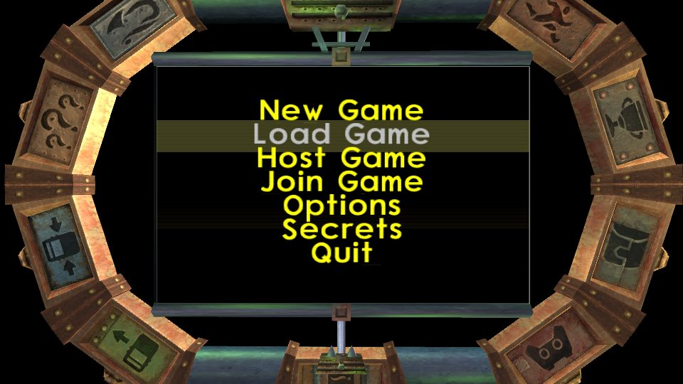
  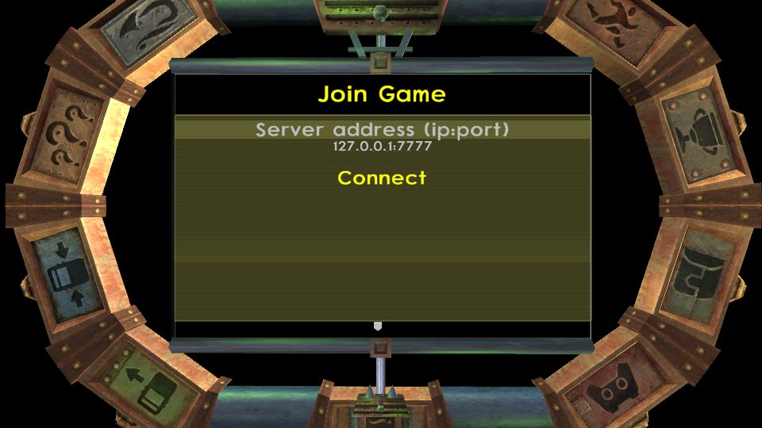
</p>

### Meet in the lobby
Everyone picks Jak or Daxter and says they are ready. The host picks the game mode and starts a 10-second countdown. Two modes can be played: **Free roam** and **Co-op**. The others are listed as coming soon.

<p>
  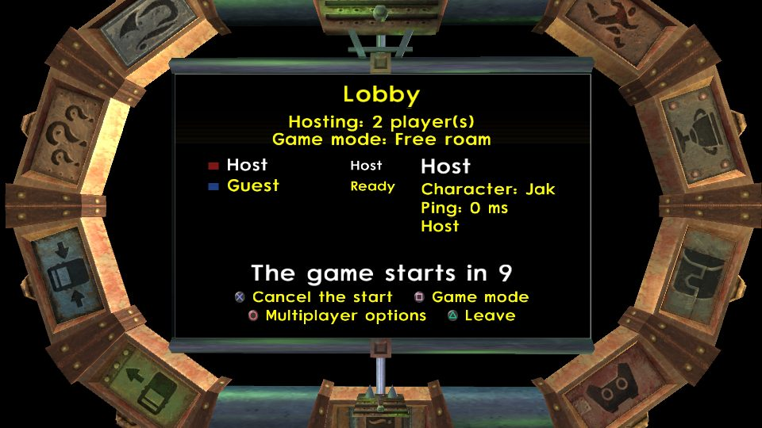
  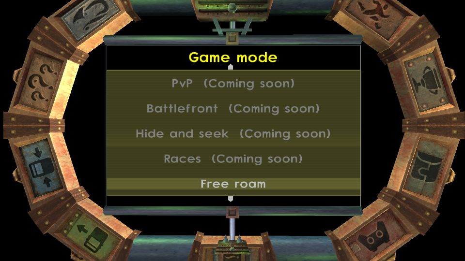
</p>

### Play as Daxter
Daxter is a full character: he fires every gun, drives vehicles and rides lizards. Next to a Jak, press **L1 + triangle** to jump on his shoulder and ride along; **X** jumps off.

<p>
  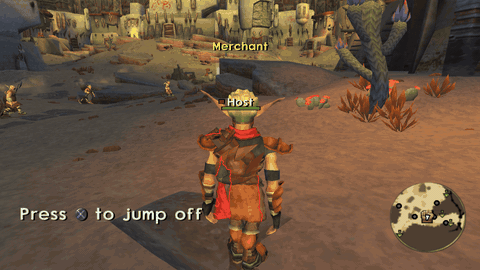
</p>

### See each other
Every player shows with their name, health bar and color. Hold **SELECT** to see the player list with each player's health and ping.

<p>
  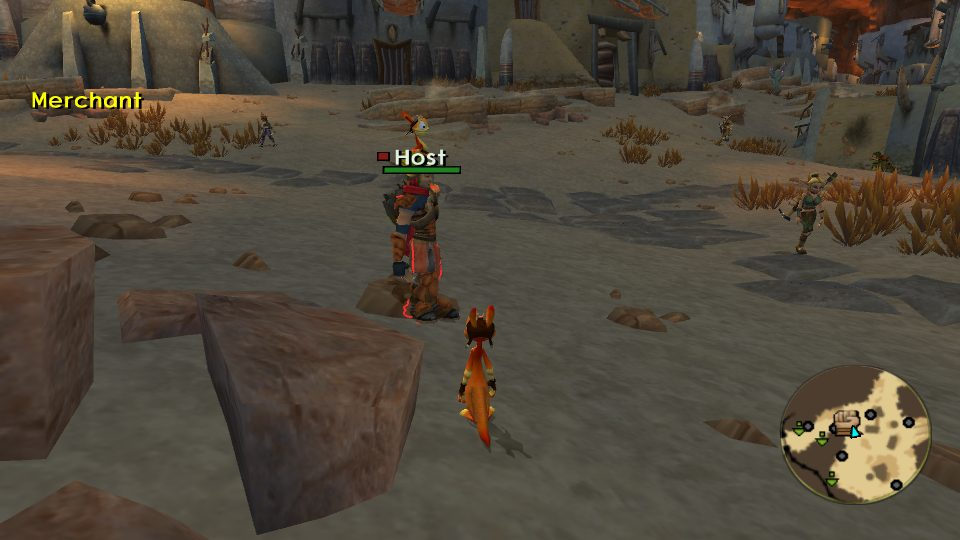
  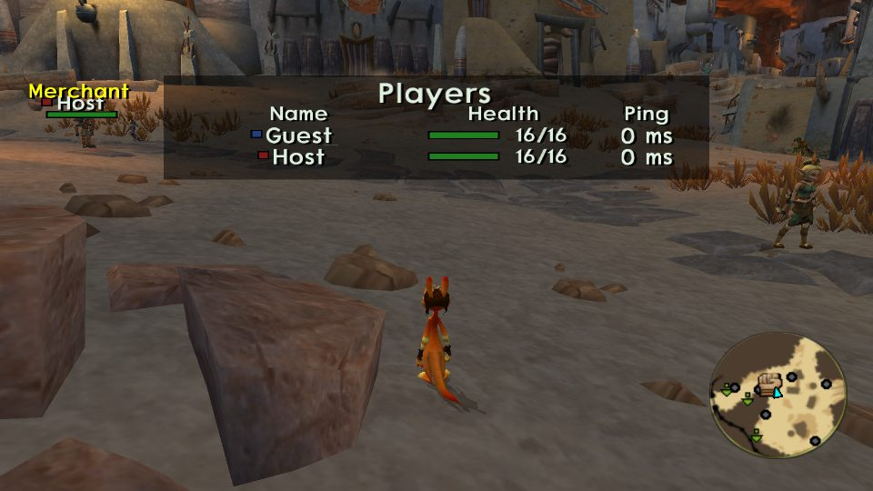
</p>

A player hidden behind a wall or a vehicle shows as an outline in their color.

<p>
  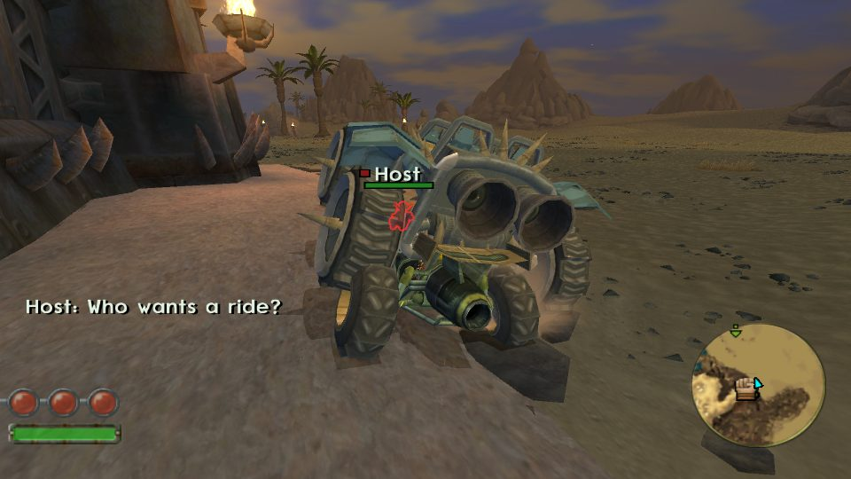
</p>

### Free roam: earn orbs, shop at Kleiver's
Free roam is the end of the game with everything unlocked. Every precursor orb you take counts for you, and the host's server keeps your orbs and purchases between sessions. Kleiver waits in Spargus: press **triangle** next to him to buy outfits and the gun's higher mods.

<p>
  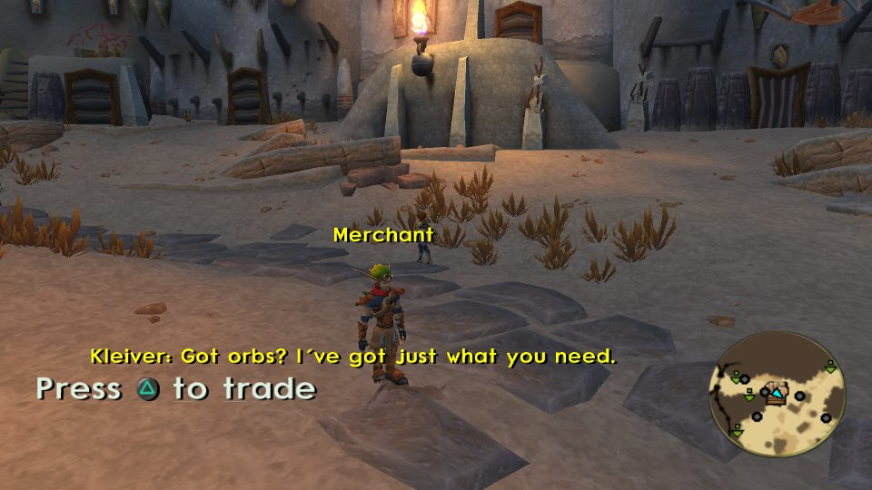
  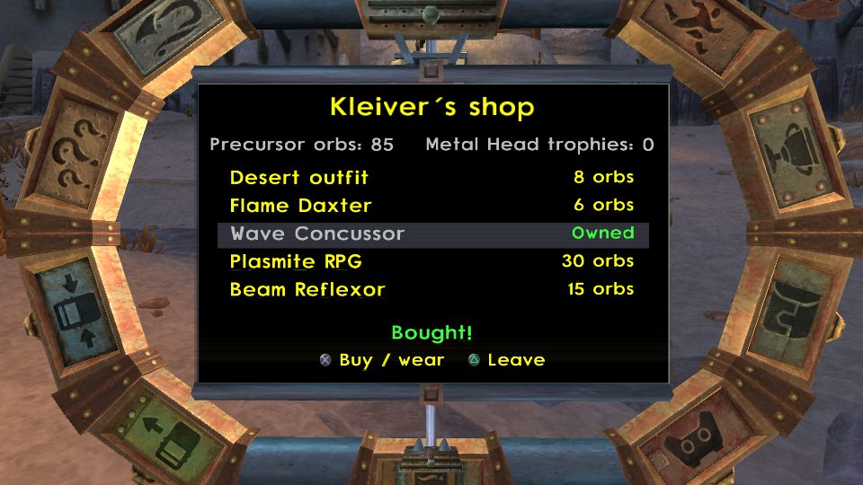
</p>

### Text chat
Press **T** on the keyboard to write and **Enter** to send. The host can also type commands, such as `/players`, `/kick` or `/give`; their answers show in yellow.

<p>
  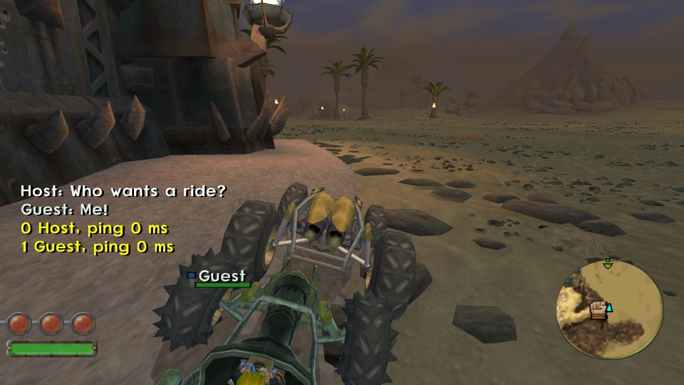
</p>

### Co-op: the story together
Two players play the story as Jak and Daxter. The host starts a new campaign, continues the saved one, or picks any mission.

<p>
  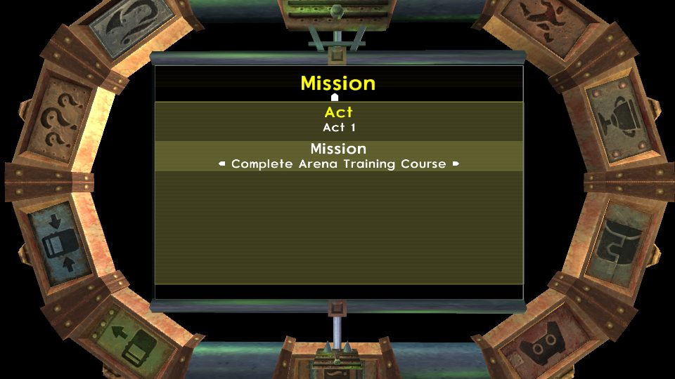
</p>

When one player starts a mission, the other is asked to join. Both watch the cutscene, and it is skipped once both ask.

<p>
  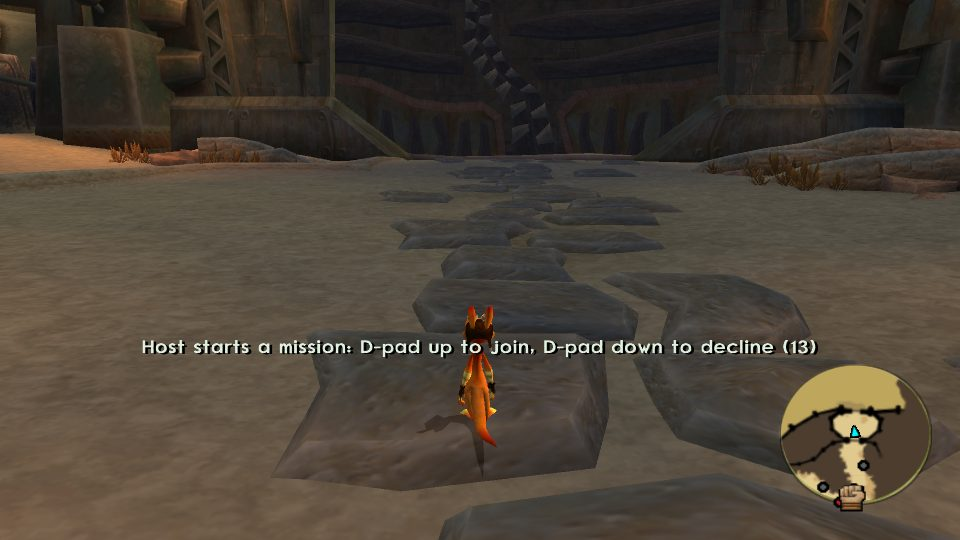
  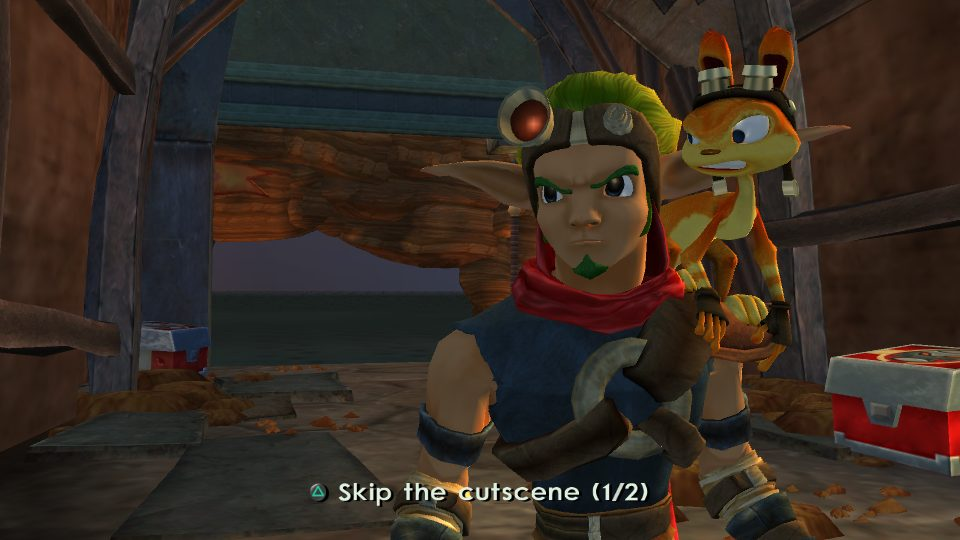
</p>

The campaign saves itself, apart from your single-player saves, and the save icon shows on both screens. Where the story gives Jak a lizard, each player gets one.

<p>
  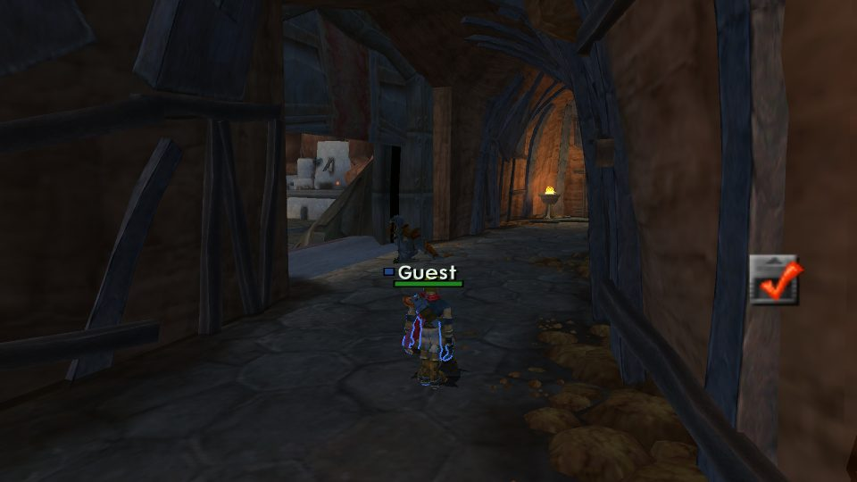
  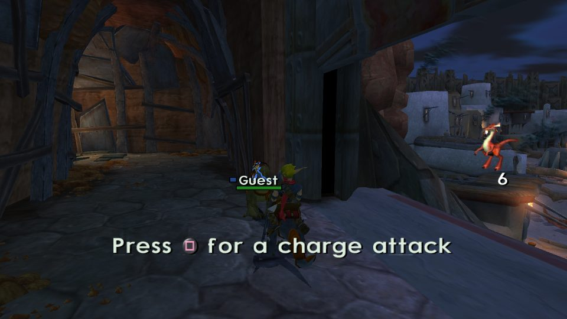
</p>

### Share vehicles
Next to another player's vehicle, press **triangle** to steal it, or **L1 + triangle** to ride along in a free seat.

<p>
  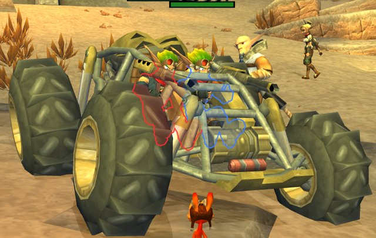
</p>

### Your own look
The Appearance page gives a color to each part of Jak's and Daxter's clothes. Every player sees your outfit.

<p>
  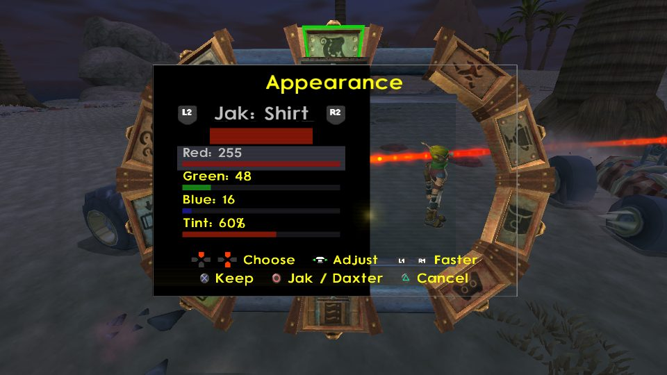
</p>

### And also
- **One shared world:** citizens, guards, enemies and traffic are the same for everyone. Enemies killed, crates broken and doors opened are shared.
- **Shared story:** a mission completed by one player is completed for all.
- **Your save is safe:** joining loads the host's world and never writes into your own save.
- **Pause for everyone** with the host's SELECT.
- **Server administration** for the host: kick, ban, teleport players, allow cheats for guests.
- **Cheats menu** (L3 + SELECT): every weapon, ammo, health, eco, 100 precursor orbs, 100 skull
  gems, invincibility, teleports.

## Getting Started

Every player needs the mod installed ([Download & Play](#download--play-via-opengoal-launcher-players)),
in the same version.

### 1. Multiplayer is on
The mod is on from the first boot: the title screen lists **Host Game** and **Join Game**, and the
pause menu has **START > Options > Multiplayer**. To play the stock game, open the Mods menu with
**L3 + SELECT**, go to **multiplayer** and turn off **Enable multiplayer (START > Options)**. The
setting is remembered.

### 2. Choose your name and look (optional)
In **START > Options > Multiplayer**:

| Option | What it does |
|---|---|
| Player name | Shown over your head, in the player list and in the chat. |
| Character | Jak or Daxter. |
| Color | One of ten colors: the square before your name and your marker on the minimap. |
| Appearance | A color for each part of Jak's and Daxter's clothes, with a turning preview. Everyone sees your outfit. |
| Server address | The host's address you join, or the port you host on. |

Text fields open an on-screen keyboard: move with the D-pad or the stick, X types the key, square
deletes, L1 switches capitals, START (or the OK key) keeps the text, triangle cancels.

### 3. Host a server
On the title screen, pick **Host Game**. The server starts and its lobby opens at once, so the
others can join right away. It listens on the port of your Server address (7777 by default).
Give the others the address they need:

| Where the others play | Address to give |
|---|---|
| Same local network | Your computer's local IP and the port, for example `192.168.1.20:7777`. |
| Over the Internet | The address in the status line: "Hosting: 1 player(s), internet address ...". |

> [!NOTE]
> **Playing over the Internet:** the game asks your router to open its UDP port by itself (UPnP,
> else NAT-PMP). Once the port is open, the status line at the top of the lobby and of START >
> Options > Multiplayer shows the internet address. If it never shows, forward the UDP port (7777,
> or the one you chose) on your router by hand, then give your public IP address with the port.
> Connections are encrypted.

### 4. Join a server
On the title screen, pick **Join Game**, type the host's address (`ip:port`) and pick **Connect**.
You arrive in the host's lobby; if its game has already started, you follow into it within about
10 seconds. If the connection fails, the message tells you why:

| Message | What to do |
|---|---|
| Connection refused / Connection timed out: is the server running? | Check the address and port, and that the host is in its lobby or game. Over the Internet, the host's port must be open. |
| The server is full | The server takes 8 players, 2 in co-op. |
| Version mismatch: update the mod | Install the same version of the mod as the host. |
| You are banned from this server | The host banned you until its server stops. |

### 5. The lobby
- Everyone picks **Jak or Daxter** with L1 / R1.
- The guests press **X** when they are ready.
- The host presses **square** to choose the game mode ([Online Modes](#online-modes)).
- Once every guest is ready, the host's **X** starts a 10-second countdown that every player
  sees; the host's X again cancels it. When it ends, every player loads the host's world.
- **Circle** opens the multiplayer options, **triangle** leaves the lobby.

When the host leaves, stops the server or quits, every player goes back to the title screen with
"The host ended the session".

## Online Modes

| | Free roam | Co-op |
|---|---|---|
| Players | Up to 8 | 2 |
| Characters | Each player picks Jak or Daxter | One Jak and one Daxter |
| World | The end of the game, everything unlocked | The story, from the start, your campaign or a chosen mission |
| Progress saved | The world is not saved; the server keeps every player's orbs and purchases | The campaign saves itself on the host's computer |
| Economy and Kleiver's shop | Yes | No |
| Players can hurt each other | Yes, unless the host turns it off | Never |

The game mode list also shows Parkour, Egg hunt, PvP, Battlefront, Hide and seek and Races, grayed
out: they are planned, not playable yet.

### Free roam

**Start it:** in the lobby, the host presses square, picks **Free roam**, then starts the
countdown. Everyone appears in Spargus at the end of the game.

**What you get:** every story mission is done, and everything is unlocked for every player: the
gun's four colors with their ammo upgrades, Dark and Light Jak's powers, the hoverboard and the
vehicles. Each gun color starts at its first mod; the second and third are bought at Kleiver's
shop.

**What to do:** go where you want, alone or together. The activities that pay precursor orbs (the
burning bush challenges, the gun courses, the turret game, the power game) offer themselves again
once done, and pay again. When a player starts a challenge, the others can join it within 30
seconds (D-pad up).

#### Earning orbs and trophies
- Every **precursor orb** you pick up counts for you. Each orb pays once on a server, to whoever
  takes it first: an orb already paid in an earlier session pays nothing again.
- Every **Metal Head** you kill gives you a **Metal Head trophy**. Trophies are counted on your
  account; nothing spends them yet.

#### Kleiver's shop
Kleiver stands in Spargus, at one of four places drawn at random for each session, the same for
every player. His face marks the place on the minimap, and "Merchant" shows in yellow over him.
Stand next to him and press **triangle** to trade: **X** buys an item or wears an outfit you own,
**triangle** leaves.

| Item | Price (precursor orbs) |
|---|---|
| Gold outfit | 5 |
| Shadow outfit | 10 |
| Desert outfit | 8 |
| Flame Daxter | 6 |
| Wave Concussor (red, second mod) | 15 |
| Plasmite RPG (red, third mod) | 30 |
| Beam Reflexor (yellow, second mod) | 15 |
| Gyro Burster (yellow, third mod) | 30 |
| Arc Wielder (blue, second mod) | 15 |
| Needle Lazer (blue, third mod) | 30 |
| Mass Inverter (dark, second mod) | 20 |
| Super Nova (dark, third mod) | 40 |

A third mod needs its color's second mod first. In free roam, the Mods menu's "Give every weapon"
gives only the mods you bought.

#### Your account on a server
- The host's computer is the server: it keeps every player's orbs, trophies and purchases in its
  own database, written at once, and finds them again each time it hosts.
- Your account follows you, not your name: it rests on a secret id that your game draws once and
  never sends. Each server sees a different account id for you, so another server starts you at
  zero.
- The secret id and the server's own id live in `multiplayer.cfg`, in the game's settings folder
  (`%APPDATA%\OpenGOAL\jak3\settings\` on Windows). Keep that file: without it, a player starts a
  new account everywhere, and a host's server no longer recognizes anyone. The server's database is
  `multiplayer-server.db` in the host's settings folder.
- The host is trusted with the accounts, as on a game server hosted at home: its Mods menu gives it
  100 orbs or 100 trophies, and its chat commands credit any player. Those gifts also raise the
  orbs and skull gems the game shows.

### Co-op

**Start it:** co-op takes 2 players, so the mode is grayed out while more than one guest is in the
lobby. The host presses square, picks **Co-op**, then one of:

| Choice | What starts |
|---|---|
| New campaign | The story from its start. |
| Continue the campaign | The co-op campaign where it was last saved. |
| Choose a mission | An act, then one of its missions, with everything before it done. |

In game, the host can start another mission for both players from **START > Options > Multiplayer
> Choose a mission**. There is always one Jak and one Daxter: a guest who picks the host's
character is offered the other one, and **START > Options > Multiplayer > Character** swaps the
roles.

#### The co-op save
- The campaign saves itself on the host's computer, into its own file (`multiplayer-campaign.bin`,
  next to the memory card saves in `%APPDATA%\OpenGOAL\jak3\saves\`), never into a single-player
  slot.
- It saves after each step of the story (a mission's start or end) and wherever the game saves by
  itself. The save icon shows on both screens each time.
- The pause menu's Save Game saves the campaign at once ("Co-op progress saved"); its Load Game
  waits for the end of the session.
- The guest's own save is neither loaded nor overwritten.

#### Playing the story together
- **Missions:** when one player talks to a mission giver, the other is asked to join (D-pad up to
  accept, D-pad down to decline, 15 seconds). Both must accept; the cutscene then waits while the
  other player is brought there.
- **Cutscenes:** both players watch them together, started at the same moment once both have
  loaded them. One is skipped once both press triangle; only the host can pause it. Jak wears the
  host's outfit, Daxter the outfit of the player who plays him.
- **Collecting together:** objects a mission counts are shared. In the arena training, a token
  either player takes disappears for both, and both counters go down.
- **Same timers:** a mission's timer reads the same on both screens.
- **Enemies:** they attack both players, the nearest first. In the wasteland, both players see the
  same marauders and can destroy them.
- **Waiting for each other:** a waypoint (the yellow beam) waits for both players ("Players here:
  1/2"), and a door that unloads the place behind it stays open for the player still behind it.
- **Death and failure:** a player who dies on foot near a living partner watches them for 5
  seconds, then comes back next to them, the camera on them again. A failed mission shows for both
  players and waits for both to choose retry or quit.
- **Races:** each player drives their own vehicle in the same race, and the race is won when one
  of the two finishes first.
- **Every mission plays in co-op:** each player gets their own leaper, turret gun, torpedo, bomb
  robot or mech, and where the game leaves a lizard, two wait side by side.
- **Burning bush challenges:** the other player can join for 30 seconds (D-pad up). Both play with
  their own score; the best of those who complete it gets the reward. The other one gets the
  failure screen: retry the challenge from its start, or quit.
- Players cannot hurt each other or each other's vehicles.

## Chat and Server Commands
The chat works with a keyboard only. Press **T** to write, **Enter** to send, **Escape** to cancel,
Backspace to erase. The last lines show at the left of the screen. A line holds 96 characters at
most, and accented letters lose their accent.

The host administers the server from the chat. A name can be shortened to its beginning, and case
does not matter.

| Command | Effect |
|---|---|
| `/help` | Lists the commands. |
| `/players` | Each player's slot, name and ping. |
| `/kick name` | Disconnects that player. |
| `/ban name` | Disconnects that player and refuses them until the server stops. |
| `/tp name` | Brings that player next to the host. |
| `/tpall` | Brings every player next to the host. |
| `/give name orbs` | Gives that player precursor orbs (a negative number takes some); in free roam, its account too. |
| `/trophies name count` | Gives that player skull gems; in free roam, Metal Head trophies on its account too. |

The same administration is in **START > Options > Multiplayer > Server administration** while you
host: kick, ban, teleports, cheats for guests, players hitting each other, sharing story progress
and your time of day, stopping the server.

## Controls

| Action | Control |
|---|---|
| Mods menu (every weapon, cheats, teleports) | L3 + SELECT |
| Lobby: character / ready or start / game modes | L1 or R1 / X / Square |
| Lobby: multiplayer options / leave | Circle / Triangle |
| On-screen keyboard: type / delete / capitals / done / cancel | X / Square / L1 / START / Triangle |
| Player list | Hold SELECT |
| Host: pause / resume for everyone | SELECT |
| Chat: open / send / cancel / erase (keyboard only) | T / Enter / Escape / Backspace |
| Daxter: choose the gun mod / fire | D-pad / R1 |
| Daxter: climb onto a crouching or driving Jak's shoulder / jump off | Triangle / X |
| Daxter: jump on Jak's shoulder at any time | L1 + Triangle next to him |
| Steal a player's vehicle | Triangle next to it |
| Ride as a passenger / get off | L1 + Triangle next to it / Triangle |
| Get on a lizard (Jak or Daxter) | Triangle next to it |
| Join a challenge another player started | D-pad up (30 s) |
| Free roam: Kleiver's shop: open / buy or wear / leave | Triangle next to him / X / Triangle |
| Co-op: accept / decline a mission the other player starts | D-pad up / D-pad down (15 s) |
| Co-op: ask to skip a cutscene | Triangle |

## Download & Play via OpenGOAL Launcher (Players)

> [!TIP]
> **No developer environment required!** Players can install and play this mod directly using the official OpenGOAL Launcher:

### Option A — Add Custom Mod Source (Recommended)
1. In the **OpenGOAL Launcher**, navigate to **Settings ▸ Mods ▸ Add Custom Mod Source**.
2. Paste this catalog URL:
   ```text
   https://raw.githubusercontent.com/whozghiar/jak3-multiplayer/main/index.json
   ```
3. Go to the **Mods** tab, locate **Multiplayer**, and click **Install**.
4. Select your clean PS2 game ISO when prompted. The launcher will automatically extract assets and launch the game!

### Option B — Manual Installation from GitHub Releases
1. Download the pre-built package for your operating system from the [Releases](https://github.com/whozghiar/jak3-multiplayer/releases) tab (`windows-multiplayer-v*.zip` or `linux-multiplayer-v*.zip`).
2. Extract the archive into your OpenGOAL Launcher features directory:
   - **Windows:** `%APPDATA%\OpenGOAL-Launcher\features\jak3\mods\_local\multiplayer\`
   - **Linux:** `~/.config/OpenGOAL-Launcher/features/jak3/mods/_local/multiplayer/`
3. Launch the game from the OpenGOAL Launcher.

---

## Developer Setup & Local Compilation

If you want to modify or compile this mod locally from source:

### 0. Get the Source
Already working in a clone of [`whozghiar/jak-project`](https://github.com/whozghiar/jak-project)? Switch to this mod there, keeping your extracted game data:
```bash
task modding-switch -- jak3-multiplayer
```
Otherwise clone it on its own; the knowledge base used by AI agents is a submodule, so clone with it:
```bash
git clone --recurse-submodules https://github.com/whozghiar/jak3-multiplayer.git
```
To pull the latest modding base into this mod later, run `task modding-sync-branch`.

### 1. Select the Active Game
Make sure your environment is targeting Jak 3:
```bash
task set-game-jak3
```

### 2. Binary Compilation
- **Status:** `task build-release-game` (the runtime `gk` changed).
- **Details:** the network layer lives in the game runtime (`game/kernel/jak3/kmultiplayer.cpp`).
```bash
# GOAL-only mod: nothing to build — go straight to the REPL below.
# Engine / compiler C++ changed:
task build-release-game
# Decompiler or decompiler/config changed (then step 3 is mandatory):
task build-release-decomp
```

### 3. Asset Extraction
- **Status:** Standard extraction sufficient.
- **Details:** no custom asset. The mod only moves the playable-Daxter animations (on foot,
  driving, holding the gun) into the always-loaded GAME package, which the normal build does.
```bash
task extract
```

### 4. Launch the Game
Run the game natively:
```bash
task boot-game
```
*(Or launch via the OpenGOAL REPL using `task repl`, then compile and run with `(mi)` and `(r)`).*

To try a session alone, `python scripts/mp-test/local_pair.py` starts two copies of the game side
by side, one played with the controller and one with the keyboard; join with `127.0.0.1:7777`.

## Demonstration Video

[](https://youtu.be/{YOUTUBE_ID})

**[Watch the demonstration video on YouTube](https://youtu.be/{YOUTUBE_ID})**

> [!NOTE]
> *Demonstration videos must be hosted externally on YouTube to prevent repository bloating. Replace `{YOUTUBE_ID}` with your YouTube video ID (e.g. `MnqnybexhSA` from `https://youtu.be/MnqnybexhSA`).*

## Technical Documentation
- [How it works](docs/modding/current_mod/multiplayer_technical_overview.md): the mod's mechanics
  explained step by step (sessions, shared world, co-op, economy, chat, tests). Start here.
- [Technical notes](docs/modding/current_mod/multiplayer_readme.md): every detail, the vanilla
  touch points, the test scenarios, the known limits and the change log.
- [GitHub workflow](docs/modding/current_mod/github_workflow.md): from a commit to a release, and
  what each GitHub Actions workflow does.

## Credits
The title screen's Host Game and Join Game, the lobby and its countdown, the SELECT player list,
the passengers' seats and binding (L1 + triangle), the Appearance page, the Jak and Daxter
co-op duo, Daxter riding on Jak's shoulder, the outfits in cutscenes, the return next to a
teammate, the session's end screen and the adaptive network delay follow himstan's
[Jak and Daxter II Multiplayer](https://github.com/himstan/Jak-And-Daxter-2-Multiplayer)
(ISC license), rewritten for Jak 3.

---
*(AI-assisted)*
