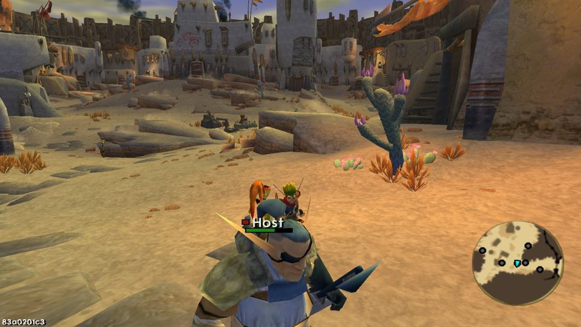
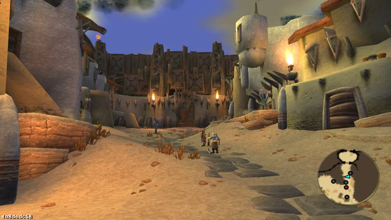
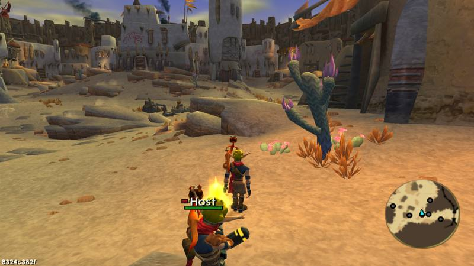
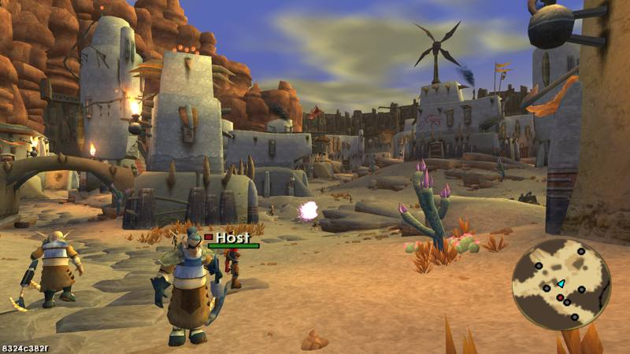
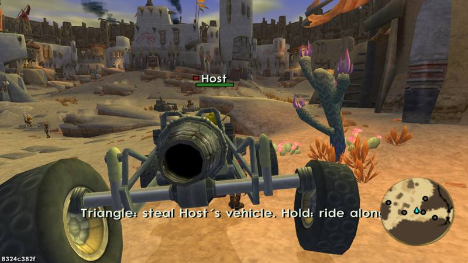
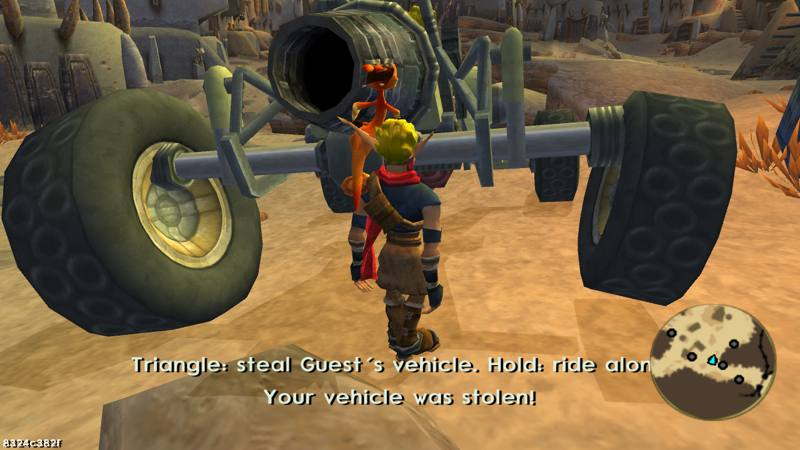
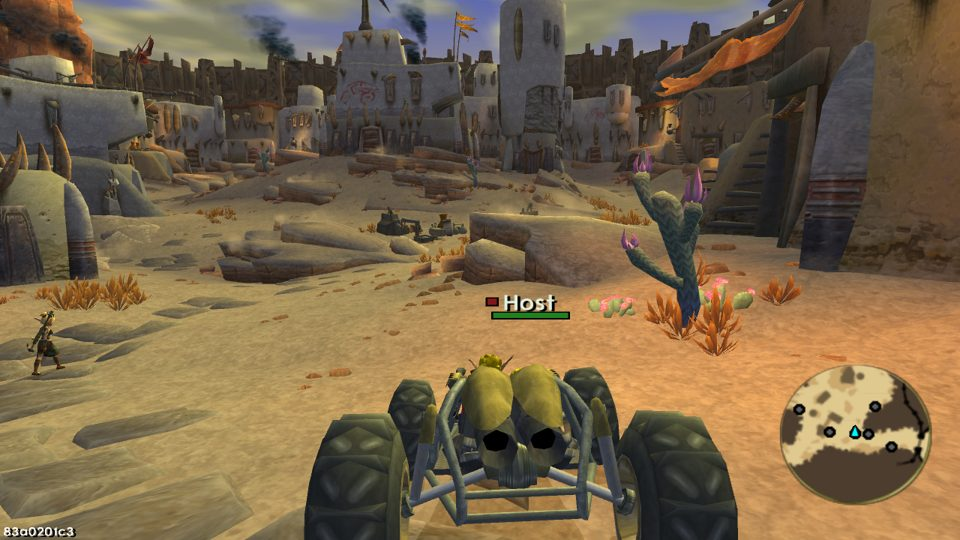
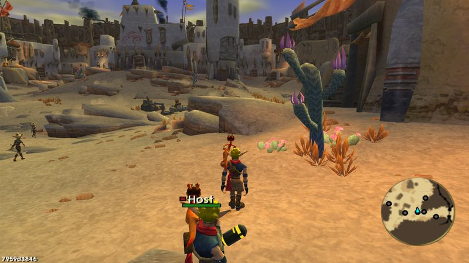
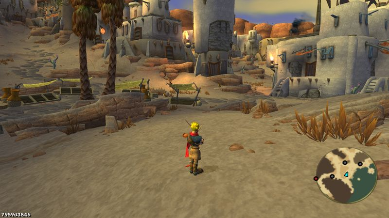

# Multiplayer (Jak 3): technical notes

How the online mod is built: the network layer in the runtime, the GOAL side, the shared world,
the vanilla hook points, how to test it in game automatically, its limits, and the change log.
Player-facing description: the root [`README.md`](../../../README.md). GOAL patterns referenced
here live in the Lisp wiki ([`.agents/skills/goal-lisp/wiki/`](../../../.agents/skills/goal-lisp/wiki/index.md)).

## 1. Architecture

Two layers, one rule: C++ moves bytes, GOAL gives them meaning.

| Layer | File | Role |
|---|---|---|
| Runtime (C++) | `game/kernel/jak3/kmultiplayer.cpp`, `.h` | TCP session (host or client), relay, player slots, kick and ban, interpolation of players, objects and poses, pose encoding, config file, test scripts. Exposed to GOAL as the `pc-mp-*` kernel functions, registered from `InitMachine_PCPort` (`game/kernel/jak3/kmachine.cpp`). |
| Runtime (C++) | `game/sce/libpad.cpp` | Pad 0 input forced by a test script (buttons with their pressure, left stick). |
| Test | `test/test_kmultiplayer.cpp` | Interpolation and a loopback host + client session (join, relay, event, objects, a pose with an emitter and a sound, ban, refusal reason). |
| GAME | `goal_src/jak3/pc/features/multiplayer/multiplayer.gc` | Local state, remote puppets (in their player's outfit) and their hurtboxes, passenger seat, shared enemy deaths and story progress, hit forwarding, player hits, Daxter mode, cheats state, teleports, overlay, per-frame hook. |
| GAME | `.../multiplayer-world.gc` | The shared world: who simulates which NPCs, NPC and prop replication, full poses, particle emitters and sounds, sleeping NPCs, hits on replicas, NPC vehicles, effects, projectiles, crates and pickups. |
| GAME | `.../multiplayer-menu.gc` | START > Options > Multiplayer and its administration page, the D-pad text field, the Mods menu entries. |
| GAME | `.../multiplayer-test.gc` | Automated test commands (inert without `MP_TEST_SCRIPT`). |
| Tool | `scripts/mp-test/run_mp_test.py`, `scenarios/`, `compare_poses.py` | Runs several game instances on one PC with a script each, gathers logs and screenshots; compares an owner's bones with its copies'. |

### 1.1 Network

- **Topology:** star. The host is slot 0 and listens on the port of its address field (default
  7777); guests get slots 1 to 7. Every message from a guest goes to the host, which relays it.
- **Transport:** TCP with `TCP_NODELAY`, non-blocking sockets pumped once per frame from GOAL
  (`pc-mp-update`), no thread. A frame is `[u16 length][u8 type][payload]`; malformed or
  oversized frames drop the peer. Message types: `HELLO` (protocol version, now 2), `WELCOME`
  (slot), `REJECT` (reason, then close), `STATE`, `LEAVE`, `EVENT`, `ACTORS`, `POSES`.
- **Player state:** `mp-player-state` (192 bytes: position, orientation, velocity, animation,
  health, flags, character and outfit, body segments, driven vehicle, passenger seat, name, color,
  level, continue point) at 30 Hz.
- **Objects:** `mp-actor-state` batches (80 bytes each, at most 64 per batch) at 15 Hz from every
  player: `[u8 source][u32 source time][u16 count][states]`. Ids carry the owner's slot in the
  top byte and the owner's process pid below.
- **Poses:** sent with each object batch, `[u8 source][u32 source time][u16 count]` then one entry
  per object: `[u32 id][u16 bones][u8 emitters][u8 sounds]`, each bone 20 bytes (rotation,
  translation to 1 mm, per-axis scale, relative to the object's frame), each emitter 20 bytes,
  each sound 40 bytes. Split over several frames of at most 16 KB. About 1.3 KB per Jak pose.
- **Events:** `mp-event` (80 bytes), routed by slot (`to = -1` for everyone). The kinds are
  defined in GOAL (`mp-event-kind`); the C++ side only stamps the sender.
- **Timeouts:** 15 s of silence drops a peer, 8 s to connect. The pump runs from the per-frame
  hook even while paused, so a paused player does not time out.
- **Config:** `<settings>/multiplayer.cfg` (`%APPDATA%/OpenGOAL/jak3/settings/` on Windows):
  name, address, character, color, enabled.

### 1.2 The shared world

Every player owns its avatar and props. The NPCs belong to an authority: the host for everyone
near it, and a guest far from every authority for itself and the guests near it (1.4).

| What | Simulated by | Seen by the others as |
|---|---|---|
| The player, its pose, outfit, health | its player | an `mp-puppet` (Jak in the player's outfit, or Daxter in `indax` mode) with the player's exact pose |
| Daxter on the shoulder, the gun, the vehicle driven and its wheels | its player | replicas of those props, with their exact pose |
| NPCs: the `enemy` family (citizens, guards, monsters, marauders...), vehicles and wheels near a player | that player's authority | replicas with their exact pose; a player who is not an authority keeps its own NPCs asleep and its traffic off |
| One-shot effects (part-trackers) | where they start | the same effect started at the same place |
| Continuous particle emitters and direct particle launches of a player, its props, the NPCs | their owner | the same emitter on the copy, at the same place on it |
| Sounds of a player, its props, the NPCs (one-shot and lasting, such as engines) | their owner | the same sound at the copy, lasting sounds updated and stopped like the owner's |
| Projectiles | the shooter's machine (the authority for NPCs) | a copy fired from the puppet or the replica |
| Enemy deaths, broken crates, taken pickups | where they happen | the same entity dying or removed |
| Story progress: closed task nodes (missions done, with their rewards) | where they close | the same nodes closed; a player who joins gets the others' and gives its own (1.5) |
| Time of day | the host | followed by the guests |
| World objects that carry or block the player (lifts, platforms, doors) | every machine, for its own player | each player's own: a lift must answer the player standing on it, so it is not driven from another machine |

A replica is built from the owner's skeleton (`mp-skel-of` finds the skeleton-group from the
process's art group and joint geometry, since a process does not keep it) and plays the owner's
animation by index, which plays the animation's effects (footsteps, sounds) on the replica
itself. The owner's full pose then replaces its bones (1.4). Both players and objects are drawn
100 ms in the past, interpolated with the owner's clock, so props stay on the puppet that carries
them.

### 1.3 Who applies damage

Each blow or shot counts once, on the machine that owns the victim:

| Blow | Detected on | Applied by |
|---|---|---|
| A player's punch or shot on another player | the attacker's machine (its hurtbox for that player) | the victim, as a stock hit with knockback (`pvp` event) |
| A player's punch or shot on an NPC replica | the attacker's machine | the host, on the real NPC, from the attacker's puppet (`actor-hit`) |
| An NPC's melee on a player's puppet | the host | that player (`hit` event) |
| An NPC's shot | every machine, on its own player, with its copy of the shot | locally; puppets ignore shots |

Copies of a player's shots collide with the background only: they are drawn, the shooter's machine
sends their hits.

### 1.4 Poses, emitters, sounds and authority

- **Poses.** With each 15 Hz batch, a player sends the bones of its own model, of its props and of
  every NPC it sends, relative to each object's frame (the root position and orientation of its
  state, without scale). While an NPC is sent, its joint math runs in full whatever its level of
  detail on the owner's screen (`force-math`, set by `mp-force-math` and cleared once it is no
  longer sent), since another player may see it up close. An object its owner does not draw (a
  hidden prop, a player during a teleport) sends no pose: its copy is hidden too (`log`: `poses
  hidden`). A passenger's own model is hidden, so the seated model its machine draws is sent
  instead. A drawn object whose bones are not all fresh would play the animation instead (`log`:
  `poses skipped`, 0 in every scenario). The copy's `joint-control` has `mp-pose-postbind` as its
  `postbind-function`: `do-joint-math` computes the copy's bones from its own animation, then this
  function lays the owner's bones, interpolated, on the copy's frame (same bone count only). Blends,
  streamed animations, look-at and aiming joint mods, joint scales and ragdolls all come through.
- **Emitters.** Two wrapped entry points note the particle emitters of the objects sent: the
  launch-control `spawn` method (groups run every frame: flames, trails, auras) and
  `sp-launch-particles-var` without a launch control (direct launches: dust, glows). Each batch
  entry lists them, with their origin relative to the frame. The copy keeps a part-tracker per
  group (at most 4) while the owner keeps it running, and replays each direct launch as many times
  as the owner made it. `*part-id-table*` keeps the entries of unloaded levels, so a direct launcher
  carries a hash of the level holding it, and the copy uses it only from that loaded level.
- **Sounds.** `sound-play-by-name`, `sound-play-by-spec` and `sound-stop` note the sounds of the
  same objects, the latest call per sound id. The copy plays each one at its place with a sound id
  of its own per owner's id: the sound player updates a sound played again with the same id, so an
  engine stays one sound, and it stops when the owner stops it or stops updating it for 0.4 s.
- **Authority.** The host always simulates its NPCs. A guest shows the NPCs of a lower-slot
  authority within 60 m and simulates its own once farther than 90 m from all of them, after 2 s
  in the new situation (`mp-update-authority`); its state carries the `authority` flag. An
  authority sends the NPCs within 100 m of the players it serves (itself, and the players who are
  not authorities and whose nearest authority it is), and drops the copies of another authority's
  NPCs standing nearer to itself than to that player.

### 1.5 Story progress

Progress in Jak 3 is the set of closed task nodes (`*game-info* sub-task-list`). Every closure
goes through the node's `open!` method (which also closes the parents the node needs), wrapped in
`multiplayer.gc`: the node index goes to the others in a `progress` event (a 256-node bitmap), and
they close the same node with `open!`, rewards and on-close scripts included. When a player joins,
every player already there sends it all its closed nodes, and it sends its own: everyone ends with
the union. Host setting **Share story progress** (on by default).

## 2. Requirements and how they are met

| Requirement | Implementation |
|---|---|
| Create or join a server from the start menu | START > Options > Multiplayer: **Host a server**, **Join the server**, **Disconnect**, plus a status line. The ring of the start menu has exactly ten slots (36 degrees each, matching its 3D model), so the page hangs off the Options list, which gets a sixth entry while the mod is enabled. |
| IP address with port, nickname | **Server address (ip:port)** and **Player name** text fields (D-pad editing). |
| Jak or Daxter | **Character** carousel. Daxter is the stock playable-Daxter mode (`indax`), made resident in GAME (section 3). |
| Color | **Color** carousel. A marker, not a tint: a small square of the player's color before its name, and its minimap dot in that color (own copies of the stock dot class, `*mp-minimap-nodes*`). |
| Cheats menu per player | Mods menu (L3 + SELECT) > multiplayer: refill ammo, restore health, dark eco, light eco, invincibility, teleport to a zone, teleport to a player. Greyed out for guests when the host disallows cheats. |
| Health bar above players | Name, color square and health bar (green, yellow, red) over every remote player in view. |
| Shared vehicle: steal or sit next to the driver | Next to a remote driver's vehicle: press triangle to steal it, hold to ride as passenger when it has a free seat. A guest can also take the host's NPC vehicles. See 4.3. |
| Synchronize everything | Section 1.2. |
| Players hit each other, with a reaction | Section 1.3: an `mp-hurtbox` child of each puppet receives the local player's blows and shots; the victim plays the stock hit reaction, pushed away from the attacker. Host setting **Players can hit each other** (on by default). |
| Game entities focus any player | Puppets are `process-focusable` in the player collide list with `collide-spec jak`, which `enemy::find-best-focus` considers. |
| Players on the minimap in real time | Each puppet has a minimap icon in its player's color. |
| Administration page when hosting | Options > Multiplayer > **Server administration**: pick a player, kick, ban, teleport them or everyone to you, cheats for guests, players hitting each other, share story progress, share time of day, stop the server. |

## 3. Vanilla touch points

Each is marked `MOD multiplayer`.

| File | Change |
|---|---|
| `game/kernel/jak3/kmachine.cpp` | `InitMachine_PCPort` registers the `pc-mp-*` functions. |
| `game/sce/libpad.cpp` | Pad 0 input forced by a test script (buttons with their pressure, left stick). |
| `game/CMakeLists.txt`, `test/CMakeLists.txt` | The new C++ file and its test. |
| `goal_src/jak3/dgos/game.gd` | The four mod files at the end of GAME, `target-indax.o`, `target-indax-hang.o` and `jak-indax+0-ag.go`. |
| `goal_src/jak3/dgos/facc.gd`, `voca.gd`, `halfpipe.gd`, `vin.gd` | The same three objects removed: a copy in a level DGO would relink the indax states into that level's heap, and they would dangle once it unloads. |
| `goal_src/jak3/engine/ui/text-h.gc` | Text ids `#x1500`-`#x1514` and `#x1520`-`#x1529` for the start menu labels. |
| `game/assets/jak3/text/game_custom_text_en-US.json`, `fr-FR.json` | Their English and French strings. |

Wrapped at load time, each calling the stock version kept by `define-perm`:

| Function or method | File | Why |
|---|---|---|
| `enemy` `mark-as-dead` | `engine/common-obs/enemy-states.gc` | Share enemy deaths. |
| `progress` `set-menu-options` | `pc/progress/progress-pc.gc` | The `'multiplayer` page. |
| `part-tracker-init-base` | `engine/common-obs/generic-obs.gc` | Every one-shot effect starts there. |
| `projectile-init-by-other` | `engine/common-obs/projectile.gc` | Every projectile starts there (the stock one never returns, so the shot is sent first). |
| `process-entity-status!` | `engine/entity/entity.gc` | Broken crates and taken pickups mark their entity dead there. |
| `sparticle-launch-control` `spawn` | `engine/gfx/sprite/particles/sparticle-launcher.gc` | Every running particle group goes through it (`spawn-from-mat` and `spawn-from-cspace` too). |
| `sp-launch-particles-var` | same file | Every particle launch; only the direct ones (no launch control) are noted. |
| `sound-play-by-name`, `sound-play-by-spec`, `sound-stop` | `engine/sound/gsound.gc` | Every sound a process plays or stops. |
| `game-task-node-info` `open!` | `engine/game/task/task-control.gc` | Every task node closure (story progress). |

Every wrapper only notes the call when a session is running, for a process the others draw.

The per-frame hook `*mods-menu-hook*` (`engine/game/main.gc`) is set to `mp-frame-hook`, which
calls `mods-menu-update` first.

## 4. How it works in game

### 4.1 One frame

1. `mp-frame-hook` (every frame, paused or not): runs the test script if any, describes the local
   player, pumps the network, copies the remote players' interpolated states, spawns the manager
   if missing (at most once a second when the process pool is full), then draws names, health
   bars, prompts and notifications.
2. `mp-manager` (`*pc-pool*`, frozen while paused): applies events, keeps one `mp-puppet` per
   remote player, switches the character, keeps invincibility, runs passenger and steal logic,
   finishes teleports, then `mp-world-update`: picks this player's role, sends its objects and
   their poses, emitters and sounds, keeps its NPCs asleep when it is not an authority (awake
   otherwise), keeps one `mp-replica` per object received, and stops the copies' lasting sounds
   their owner dropped.

### 4.2 Puppets

An `mp-puppet` uses Jak's model in the remote player's outfit (sent in the character byte, picked
like `target-skel-group` does, the local outfit when that model is not loaded here) or Daxter's
(`skel-sidekick`), shows the body segments the remote player shows, and takes the remote player's
exact pose (1.4). It also plays the remote player's animation by index, for the animation's
effects and for the time before the first pose: a clip not loaded here falls back to the idle
stance, or to the crouch for a driver or passenger. Its `mp-hurtbox` child sits in the actor hash,
where the player's attacks look. A model change (character, outfit) respawns the puppet.

### 4.3 Shared vehicles

- **Drawing:** the vehicle a player drives, and its wheels, are that player's props: the others
  draw replicas of them.
- **Steal (press triangle):** the thief stands where the vehicle is and asks the target for a new
  vehicle of that type (`'change-mode 'pilot #f type #t`, stock spawn path). Only once that worked
  does it send `steal`: the driver gets out and its vehicle is removed half a second later. Only
  the player vehicles: city bikes and cars (types 0-6) and Spargus buggies (12-19).
- **NPC vehicles:** a player presses triangle next to the replica of another authority's NPC
  vehicle, gets the same vehicle, and that authority removes its own (`vehicle-taken`).
- **Ride (hold triangle 0.5 s):** with a second seat no other player uses, from the ground
  (standing or crouched). An invisible `mp-seat` follows the driver's seat 1 and the player rides
  it with the stock `target-grab-ride` state. Each machine draws the passenger in the driver's seat
  as it sees that vehicle.
- **Collision:** a vehicle's copy is a solid sphere centered low (0.5 m under its root, 2.2 m): a
  sphere standing above the ground makes a player next to it crouch under its underside. A player's
  hurtbox is off while it drives or rides, else it would sit inside the vehicle and stop it.

### 4.4 Sleeping NPCs

While it is not an authority (1.4), a player turns its ambient traffic off
(`set-setting! 'traffic-spawn #f`, held by the manager) and, four times a second, puts every own
NPC to sleep: `sleep` process mask, not drawn, collision off. Everything is restored when it
becomes an authority or the session ends.

## 5. Testing in game

### 5.1 Unit tests and compile

```bash
task build-release-game                                   # gk + goalc, after any C++ change
cmake --build out/build/Release --target goalc-test
out/build/Release/bin/goalc-test --gtest_filter=Multiplayer.*
task compile-check                                        # first time in a worktree: (make-group "iso" :force #t)
```

### 5.2 Automated sessions

```bash
python scripts/mp-test/run_mp_test.py <scenario>
```

`python scripts/mp-test/compare_poses.py` compares, after a `pose-all` run, the bones the host
logged for its objects with those of their copies on the guest.

The runner starts one game per script of `scripts/mp-test/scenarios/<scenario>/`, each with its
own `--config-path` folder (a copy of the user's saves and settings, small window, side by side,
controller ignored when unfocused) and the `MP_TEST_SCRIPT` environment variable. The debug boot
loads save slot 1, so both games start in game at the same place. When the scripts are done, it
stops them and writes `out/mp-test/<scenario>/summary.txt` (every `[mp-test]` and `[multiplayer]`
line) and `screenshots/<instance>-<name>.png` (rendered by the game itself).

A script line is `<seconds> <command>`:

| Command | Effect |
|---|---|
| `enable`, `name <w>`, `color <n>`, `character <n>` | Mod settings. |
| `host <ip:port>`, `join <ip:port>`, `leave` | Session. |
| `press <button> <ms>`, `stick <lx> <ly> <ms>` | Force pad 0 (button names in PS2 order, at full pressure: X drives a buggy; stick 0-255, 128 centered). |
| `goto-player <slot> [x z]`, `face-player <slot>` | Stand next to a remote player (or x and z meters from it), turn to it. |
| `goto-npc <skeleton prefix>`, `goto-actor <n>` | Stand next to a replicated NPC, facing it. |
| `goto-crate`, `log-crates` | Stand at the nearest crate; count the live crates. |
| `gun`, `vehicle <type>`, `cheat <name>`, `zone <n>`, `continue <name>` | Gameplay helpers. |
| `screenshot <name>`, `log` | Evidence: the log shows the session, the local player, the role (authority) and the own NPCs awake and asleep, every remote player and puppet, the objects sent, received and drawn, the poses sent and applied, the emitters and sounds sent and replayed, the effects and shots sent and replayed. |
| `log-pose [slot]` | Four bones of player `slot`'s puppet relative to its root, or of the own model without a slot: the owner's line and the other machine's line compare the pose with its copy. |
| `log-part <index>` | Where entry `index` of `*part-id-table*` lives (which level heap). |
| `log-me` | One line: own position, speed and state (fine-grained probes). |
| `log-pose-own <npc\|daxter\|gun\|vehicle\|wheel>`, `log-pose-copy <slot> <skeleton name\|*>` | Four bones of one of our objects (the NPC nearest to player 1, Daxter, the gun, the vehicle driven, its first wheel), and of the copies of player `slot`'s objects with that skeleton (`*`: its NPC nearest to us), with the poses laid on each copy. |
| `log-tasks`, `close-task` | Story progress: closed nodes, nodes closed after another player, the open ones; close the first open node. |

Scenarios and what they verified (2026-10-14, Spargus, every one run again after the last change):

| Scenario | Checks | Result |
|---|---|---|
| `smoke` | Host, join, puppets, names, health bars | Both see each other; poses, sounds sent and applied both ways. |
| `pvp` | A guest's punch on the host | Host health 8 to 5, pushed back 3.1 m, hit reaction seen by the guest; the guest stays in place (0.2 m). |
| `pvp-probe` | The attacker's position and state every 0.1 s around the punch | The punch lunge stops on the host's hurtbox. |
| `npc` | Host NPCs on the guest | 13 replicas drawn, the guest's own NPCs (8 to 10 around it) asleep. |
| `npc-hit` | A guest's punch on a host NPC | The host applies both blows to its citizen (`player 1 hit ... punch`); in an earlier run the citizen struck back and the guest lost 2 health. |
| `props`, `combat` | Daxter, gun, shots, impacts, emitters | Daxter on the shoulder and the gun in the aiming pose on the remote puppet; 3 shots and 2 impacts replayed; the gun's emitters replayed (122). |
| `vehicle` | A driven buggy, then stolen | Body and wheels replicated, its emitters (289 shown) and engine sound (932 updates played) on the guest; the driver is ejected and sees the thief's buggy. |
| `ride` | Passenger seat | The guest, standing 3 m beside the host's two-seat buggy, rides in it; the host drives 27 m with it. |
| `crate` | A stack of crates broken by the host | The host breaks 4 (34 to 30 around it), the guest goes from 48 to 44. |
| `pose` | The driver's pose (pilot animation), its dust and engine | The host's bones and their copy on the guest match within 5 mm (`log-pose`, 65 bones); 378 emitters shown and 1186 sounds played on the guest. |
| `pose-all` | Every object type: NPC, Daxter, gun, buggy, wheels | `compare_poses.py`: Daxter 0.7 mm, gun 0.3 mm, buggy 0.4 mm; a walking NPC logged every frame on both sides, 53 frames paired: median 5.9 mm, largest 5.5 cm while its bones move 5.1 cm per frame (the two machines' frames are not in phase); every wheel copy gets its pose each batch; no pose skipped. |
| `progress` | Story progress | The node the host closed before the guest joined reaches it on join, the one closed later live: 3 closed nodes and the same open ones on both. |
| `far` | Authority | Next to the host the guest shows its NPCs (10 own asleep); 570 m away it simulates its own (37 awake, 6 sent to the host); back next to the host, asleep again. |

| | |
|---|---|
|  |  |
|  |  |
|  |  |
|  |  |
|  | |

Over the Internet, the host forwards TCP port 7777 (or the port chosen) and guests use the host's
public IP.

## 6. Known limits

- World objects that carry or block the player (lifts, platforms, doors) belong to each player's
  own game (1.2). A mission's own scripted scenes play for the player who runs them; the others
  get the outcome (1.5).
- A copy is drawn with art loaded on the viewer's machine, like the world itself: levels load
  around each player, so an object in a level the viewer has not loaded (far away) waits until it
  is.
- At most 64 NPCs per batch and 128 copies drawn, 4 particle groups per copy, 16 emitters and 16
  sounds per object and batch. Sounds of a sound bank the viewer has not loaded stay silent.
- Bandwidth: about 1.3 KB per Jak pose and 0.6 KB per NPC pose, 15 times a second; a crowd of 40
  NPCs is about 0.4 MB/s from the authority to each player.
- Text fields use the D-pad (keyboard arrows work too).
- TCP head-of-line blocking can stall a player on a lossy link (interpolation hides short stalls).

## 7. Change log

- **2026-10-14:** first version. Network session in the runtime with its tests; START > Options >
  Multiplayer and the administration page; Mods menu entries (toggle, cheats, teleports);
  puppets with name, health bar and minimap icon, focusable by enemies with hit forwarding;
  vehicle ghosts, steal and passenger seat; playable Daxter made resident in GAME; shared enemy
  deaths and time of day.
- **2026-10-14:** fixes from a code review: text fields crashed on confirm (a static object's
  `mounted?` starts at 0, not `#f`); Host and Join fired twice; "Stop the server" ignored "No";
  refusal reasons were never sent; steal limited to player vehicle types; passengers drawn in
  their driver's seat; macOS `MSG_NOSIGNAL` fallback.
- **2026-10-14:** first in-game report: the process pool filled up and the start menu could no
  longer open. The manager's handle was kept in a global symbol, which only holds 32 bits: the pid
  was cut off, the handle never resolved, and the hook spawned a manager every frame. Handles and
  timers now live in structures.
- **2026-10-14:** second round, tested in game with the automated sessions. Players hit each other
  (hurtbox, knockback, host setting). The color is a marker before the name and on the minimap, no
  longer a tint. Shared world: host-authoritative NPCs and vehicles drawn as replicas, guests' own
  NPCs asleep and traffic off, hits on replicas applied by their owner, NPC vehicles taken by
  guests. Every player's props (Daxter, gun, vehicle and wheels) replace the ghost vehicle. Shared
  effects, projectiles, broken crates and taken pickups. A driver or passenger crouches when its
  pilot animation is not loaded. Automated multi-instance tests with screenshots
  (`scripts/mp-test/`).
- **2026-10-14:** everything synchronized. Full poses (every bone, `POSES` message, protocol 2) for
  players, props and the nearest NPCs, laid on the copies by a joint-control postbind function:
  blends, streamed animations, joint mods and ragdolls now look the same everywhere. Continuous
  particle emitters, direct particle launches and sounds of players, props and NPCs replayed on
  the copies. NPC authority by region: a guest far from every authority simulates its own NPCs and
  shares them with the players near it. Body segments of the remote player. Test commands
  `log-pose`, `log-me`, `log-part`, `goto-player` with x and z offsets; face commands now set the
  player's heading (the punch lunged the other way, which looked like a bounce). Scenarios `pose`,
  `far`, `pvp-probe`.
- **2026-10-14:** every NPC sent gets its exact pose (no budget), with full joint math while sent.
  Shared story progress (task nodes, on join and live, host setting). Remote players in their own
  outfit. Test commands `log-pose-own`, `log-pose-copy`, `log-tasks`, `close-task`; scenarios
  `pose-all`, `progress`.
- **2026-10-14:** a player standing next to another player's vehicle crouched under the underside
  of its collision sphere and could not get in as passenger: the sphere is now centered low, and
  getting in works crouched too. A passenger's hurtbox stopped the driver's vehicle: hurtboxes are
  off in vehicles. The test pad now presses buttons at full pressure (a buggy's throttle reads X's
  pressure; before, the test buggies were only pushed by the passenger's hurtbox).
