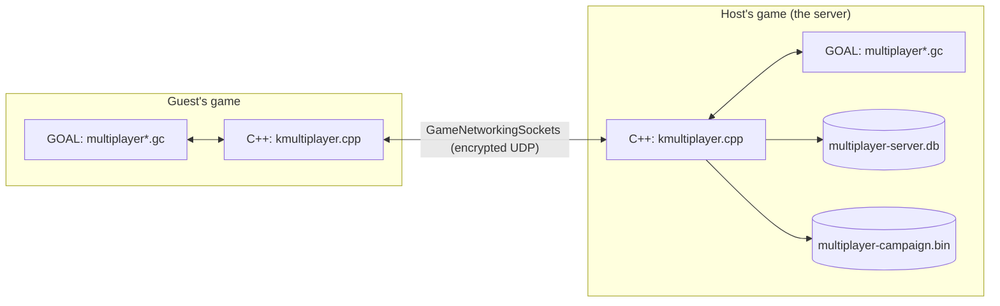

# Multiplayer (Jak 3): how it works

This page explains the mod's mechanics to a developer who has not read its code yet: how players
connect, how they see each other, how the world stays the same on every screen, how co-op keeps
two players in one story, and how the economy and the chat work. Each section stays at the level
of ideas and links to the detailed notes in [`multiplayer_readme.md`](multiplayer_readme.md),
which also holds the change log. Player-facing description: the root [`README.md`](../../../README.md).
How the repository is run on GitHub: [`github_workflow.md`](github_workflow.md).

## 1. The big picture

One rule splits the work: **C++ moves bytes, GOAL gives them meaning.** The runtime knows nothing
about Jak or missions; it carries messages, keeps files and talks to the network. The game code
decides what to send and what a message does.



| Part | File | What it does |
|---|---|---|
| Network and storage | `game/kernel/jak3/kmultiplayer.cpp` | The session, the messages, smoothing, player identity, the economy database, the co-op save file, the chat's keyboard input. GOAL calls it through `pc-mp-*` functions. |
| Router | `game/kernel/jak3/kmultiplayer_nat.cpp` | Opens the host's UDP port on its router (UPnP, NAT-PMP). |
| Renderer | `Merc2.cpp`, `TextureAnimator.cpp`, `opengl.cpp` | Outlines through walls, outfit tints, Dark Jak's skin on another player, the keyboard handed to the chat. |
| Game logic | `goal_src/jak3/pc/features/multiplayer/multiplayer.gc` | Players, events, story progress, co-op rules, economy, saves. |
| Shared world | `.../multiplayer-world.gc` | Who simulates which NPCs, copies of objects, effects, sounds, doors, elevators, cutscenes. |
| Weapons | `.../multiplayer-guns.gc` | Daxter's guns, free roam's gun mods. |
| Menus | `.../multiplayer-menu.gc` | Title screen, lobby, START > Options > Multiplayer, Kleiver's shop, Mods menu entries. |
| Chat | `.../multiplayer-chat.gc` | Chat display and the host's commands. |
| Tests | `.../multiplayer-test.gc`, `scripts/mp-test/` | Scripted sessions that drive several game instances. |

**Every frame**, `mp-frame-hook` runs (from the Mods menu hook in `main.gc`, even while paused, so
nobody times out): it describes the local player, pumps the network, and draws names, health bars
and the chat. A process, `mp-manager`, then applies the events received and keeps one copy per
remote player and per remote object. Detail: [`multiplayer_readme.md` 4.1](multiplayer_readme.md#41-one-frame).

**Off by default.** Nothing runs until the player turns on *Enable multiplayer* in the Mods menu,
and the stock functions the mod wraps behave as stock outside a session (section 9).

## 2. The session: one host, up to seven guests

- **Star topology.** The host is slot 0 and the server; guests get slots 1 to 7. Every guest message
  goes to the host, which relays it. There is no official server: the host's game is the
  reference for everything shared.
- **Transport.** [GameNetworkingSockets](https://github.com/ValveSoftware/GameNetworkingSockets)
  (Valve) over UDP, as himstan's Jak 2 mod uses it: encrypted connections, reliability,
  fragmentation and rate control come built in. Messages travel on five lanes with priorities, so
  a large transfer never delays what must arrive now:

  | Lane | Carries | Delivery |
  |---|---|---|
  | Control | Joining, leaving | Reliable, in order |
  | Critical | Each player's state, 60 times a second | Latest wins |
  | Gameplay | Events (a hit, a mission closed, a purchase, a chat line), the host's world | Reliable, in order |
  | Normal, bulk | Objects, poses, effects and sounds | Latest wins |

- **Joining** is a short conversation:

  ```mermaid
  sequenceDiagram
    participant G as Guest
    participant H as Host
    G->>H: HELLO (protocol version)
    H->>G: WELCOME (slot, server id)
    G->>H: IDENTITY (account id, section 7)
    G->>H: world request
    H->>G: BLOB: the host's game as an in-memory save (40-120 KB)
    Note over G: loads it like Load Game, then appears next to the host
  ```

  A different protocol version is refused ("Version mismatch"): every player needs the same build.
- **A guest never saves in the host's world.** The game's save function is wrapped: while a guest
  plays there, no save is written, so its own progress is safe.

Detail: [`multiplayer_readme.md` 1.1](multiplayer_readme.md#11-network) and
[1.7](multiplayer_readme.md#17-the-hosts-world-and-the-game-modes).

## 3. Seeing each other: puppets and copies

- **Each player owns itself.** Every frame, a player sends its state (position, animation,
  health, outfit, vehicle...: 224 bytes) and the bones of its model. Other machines draw it as an
  `mp-puppet`: Jak or Daxter in that player's outfit, posed bone for bone.
- **Objects too.** What a player owns or simulates (Daxter on the shoulder, the gun, the vehicle
  it drives, its shots, the NPCs it is in charge of) goes out 15 times a second, with poses in
  between for what is near another player. Each becomes an `mp-replica` elsewhere: same model,
  same pose, none of the original's code.
- **Drawn slightly in the past.** Messages arrive irregularly, so every remote object is drawn
  about 76 ms behind on a local network, between two known states. The delay follows each sender's
  lateness and the amount sent drops on a struggling connection.
- **Effects and sounds follow.** The mod notes the particle emitters and sounds started by what it
  sends, and the copy plays the same ones at the same place.
- **Outlines.** The renderer draws another player hidden behind a wall as an outline in their
  color.

Detail: [`multiplayer_readme.md` 1.4](multiplayer_readme.md#14-poses-emitters-sounds-and-authority)
and [4.2](multiplayer_readme.md#42-puppets).

## 4. One shared world

- **Authority over NPCs.** Citizens, guards, enemies and traffic run on one machine and are copied
  everywhere else. The host simulates everything near it. A guest more than 90 m away from every
  authority, for 2 seconds, starts simulating its own area and serves the guests near it; back
  near the host, it hands over. So players can split up across the map and each keeps a living
  world.
- **Damage counts once,** on the machine that owns the victim: a player's shot on an NPC copy is
  sent to the NPC's authority, a blow on another player is sent to that player.
- **Shared events.** Enemy deaths, broken crates, pickups taken, doors opening, elevator trips and
  cutscenes are announced and replayed on the other machines. Moving platforms follow the host's
  clocks.
- **Story progress** is the set of closed task nodes. Closing one is wrapped and announced, so a
  mission completed by one player is completed for all, rewards included.
- **Levels stay local.** Each machine loads the levels around its own player. A distant player's
  objects are drawn from their art alone, without loading their level's code.

Detail: [`multiplayer_readme.md` 1.2 to 1.6](multiplayer_readme.md#12-the-shared-world).

## 5. Two game modes

The host picks the mode in the lobby; both run on the same mechanics above.

| | Free roam | Co-op |
|---|---|---|
| How the world is made | A new game in Spargus, then the story's last node closed, which closes the whole story with its rewards | A new campaign, the saved one, or one mission with everything before it closed |
| Players | Up to 8 | 2, always one Jak and one Daxter |
| Saved | Only the economy, by the server | The campaign, by the host |

Detail: [`multiplayer_readme.md` 1.7](multiplayer_readme.md#17-the-hosts-world-and-the-game-modes).

## 6. Co-op: two players, one story

The story was written for one player. Co-op keeps both in the same place and the same state with
two simple tools: **votes** (both players agree before something happens) and **holds** (the game
waits for the other player).

| Moment | Tool | What happens |
|---|---|---|
| A mission starts | Vote | The other player is asked (15 s); accepted, the cutscene waits while they are brought there. |
| A cutscene | Vote | Skipped once both players asked. |
| A mission fails | Vote | One failure screen for both; they retry or quit together. |
| A waypoint | Hold | It completes once both players stand on it. |
| A door that unloads the area behind it | Hold | It stays open for the player still behind it. |
| A race | One race | The host's race counts; the other player takes a racer's place. |
| A death | Respawn | The player watches their partner for 5 s, then comes back next to them. |

**The co-op save** is a file of its own, `multiplayer-campaign.bin`, next to the memory card saves.
Only the host writes it: after each story step (a mission's start or end) and wherever the game
would auto-save. Each save sends a `coop-saved` event so both screens show the save icon.

Detail: [`multiplayer_readme.md` 4.13 to 4.34](multiplayer_readme.md#413-co-op-skipping-a-cutscene-together).

## 7. The economy (free roam)

A proof of concept: precursor orbs earned in the world buy outfits and the gun's higher mods.

- **Identity.** Each player's game draws a secret id once and keeps it in `multiplayer.cfg`; each
  server draws its own server id. The account id a guest gives a server is an HMAC-SHA256 of the
  server id keyed by the secret. The secret never leaves the machine, the account follows the
  player whatever their name, and each server sees a different id.
- **The host decides.** A guest only asks; the host checks and answers:

  ```mermaid
  sequenceDiagram
    participant G as Guest
    participant H as Host
    G->>H: I took this orb (its entity)
    Note over H: a real orb of its world? the guest within 8 m? never paid before?
    H->>G: new balances
    G->>H: buy item N
    Note over H: enough orbs? second mod owned before the third?
    H->>G: new balances and items
  ```

- **Trophies.** A Metal Head killed by a player gives that player a trophy.
- **Gun mods.** Every gun color starts at its first mod; a purchase sets that mod's feature bit
  for that player, and the game offers only the mods whose bit is set.
- **Storage.** A SQLite database, `multiplayer-server.db`, in the host's settings folder: the
  accounts, the orbs already paid, and a ledger of every change. Each change is written at once,
  so a crash loses nothing.
- **Kleiver.** The host draws one of four spots in Spargus per session and sends it to everyone;
  his model, minimap icon and shop page appear there.

Detail: [`multiplayer_readme.md` 4.20](multiplayer_readme.md#420-economy-orbs-trophies-kleivers-shop-and-the-guns-mods).

## 8. The chat

- **The keyboard alone.** While a line is typed (T opens it), the renderer gives every keyboard
  event to the chat and none to the game; Enter sends, Escape cancels.
- **Through the host.** A guest's line goes to the host, which relays it with the name it knows,
  not the one the guest claims, and limits how fast a guest can send.
- **Commands.** A line starting with `/` is a command, accepted from the host only: kick, ban,
  teleport, credit orbs or trophies.

Detail: [`multiplayer_readme.md` 4.35](multiplayer_readme.md#435-text-chat-and-the-hosts-commands).

## 9. Changing the game without editing it

The mod changes the stock game mostly by **wrapping** stock functions from its own files: it keeps
the original under another name, redefines the function, and calls the original whenever no
session changes the behavior. Saving, closing a task node, starting a cutscene, picking up an
orb or killing an enemy all pass through such wrappers. The pattern is in the Lisp wiki:
[wrapping a stock method](../../../.agents/skills/goal-lisp/wiki/jak3.md#410-wrapping-a-stock-method-from-a-game-file)
and [hooks for every effect, projectile, sound and story step](../../../.agents/skills/goal-lisp/wiki/jak3.md#413-hooks-for-every-effect-projectile-sound-and-story-step).

The few places where a stock file had to change (a race's start, the scene player, DGO lists,
text ids, the renderer) are marked `MOD multiplayer` and listed in
[`multiplayer_readme.md` 3](multiplayer_readme.md#3-vanilla-touch-points).

## 10. Testing

| Level | Command | What it proves |
|---|---|---|
| Unit | `goalc-test --gtest_filter=Multiplayer.*` | The C++ session on loopback: joining, relaying, smoothing, account ids, the chat. |
| Compile | `task compile-check` | The GOAL code builds. |
| By hand | `python scripts/mp-test/local_pair.py` | Two game windows side by side, one on the controller, one on the keyboard. |
| Scripted | `python scripts/mp-test/run_mp_test.py <scenario>` | Several game instances follow a script each (`scripts/mp-test/scenarios/`), then their logs and screenshots are checked. Options simulate lag and packet loss. |

Detail: [`multiplayer_readme.md` 5](multiplayer_readme.md#5-testing-in-game).
